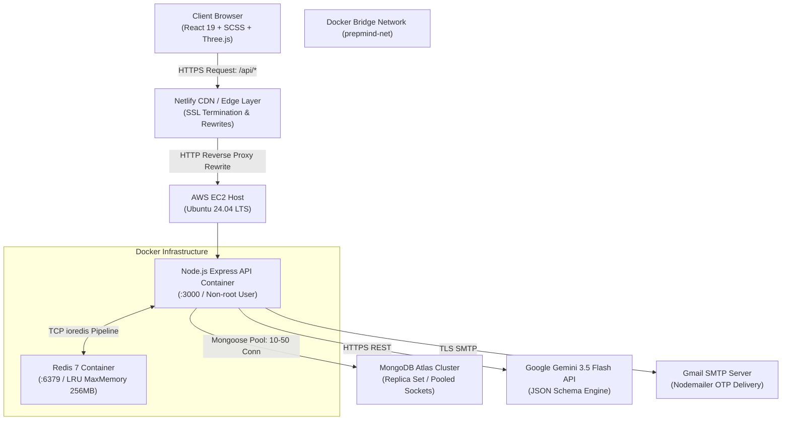
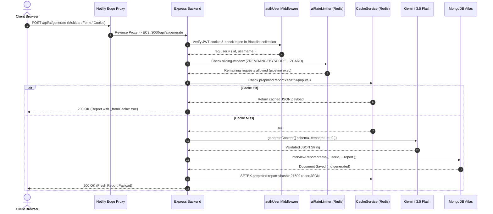
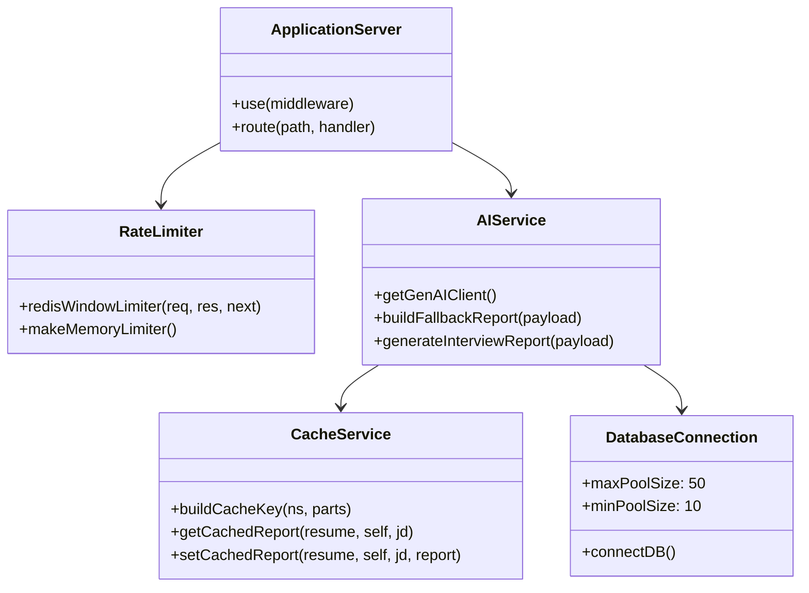
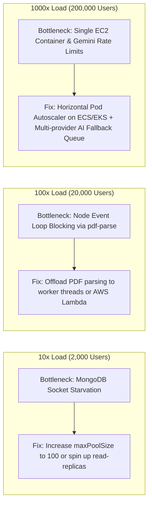
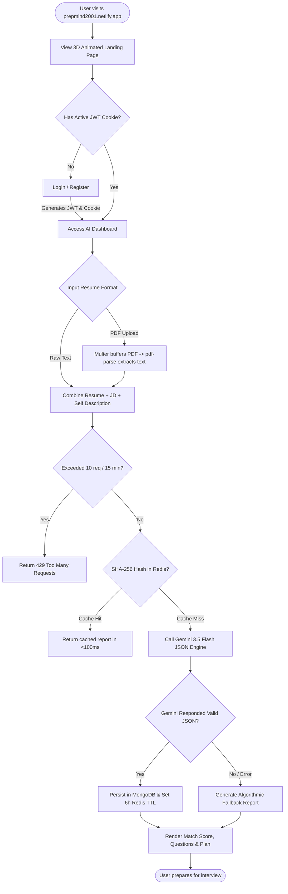
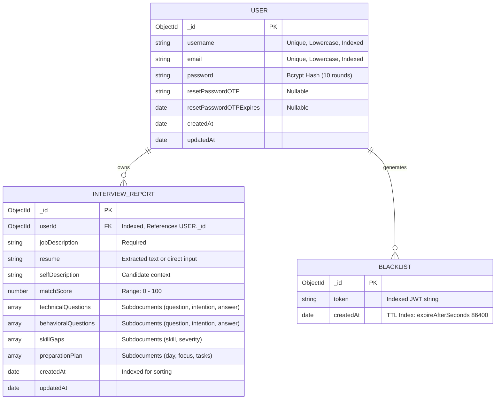
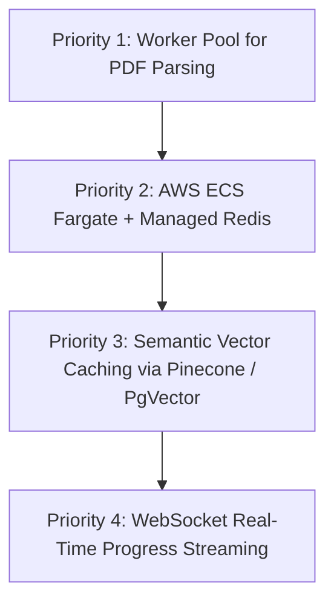

# PrepMind — Technical Interview Defense & System Design Architecture

> "This document is an interview-preparation companion. It is separate from the main README.md and focuses on design reasoning, trade-offs, and deep technical questions."

---

## Table of Contents
1. [Project Overview](#1-project-overview)
2. [Features](#2-features)
3. [Service Flow & Architecture](#3-service-flow--architecture)
4. [System Design](#4-system-design)
5. [User Flow](#5-user-flow)
6. [ER Diagram & Data Modeling](#6-er-diagram--data-modeling)
7. [Trade-offs in System Design](#7-trade-offs-in-system-design)
8. [Hard Interview Questions (Deep Concepts)](#8-hard-interview-questions-deep-concepts)
   - [Amazon-Style Questions](#amazon-style-questions-leadership-dive-deep--ops)
   - [Google-Style Questions](#google-style-questions-algorithms-systems--scale)
   - [Zomato-Style Questions](#zomato-style-questions-bursty-traffic-concurrency--cost)
9. [Gaps & Improvements](#9-gaps--improvements)
10. [Quick Revision Cheat Sheet](#10-quick-revision-cheat-sheet)

---

## 1. Project Overview

### Problem Statement
Job applicants face asymmetrical interview preparation: generic LeetCode problems or cookie-cutter behavioral flashcards fail to test the exact intersection between an individual candidate's resume and a target company's job description (JD). PrepMind acts as an automated, AI-powered interview strategist that ingests unstructured candidate resumes (text or PDF) alongside a target job description, performs gap-detection and semantic alignment via Gemini AI, and outputs a deterministic, structured strategy report: a 0–100 match score, tailored technical questions with interviewer rationale, STAR-framework behavioral questions, skill gap categorizations, and a day-by-day preparation roadmap.

### Target Users
- Software engineers, engineering interns, and technical candidates (ages 18–35) seeking targeted technical and behavioral interview preparation.
- Career changers needing to rapidly identify the technical delta between their current competencies and a job posting.

### Tech Stack & Justifications

| Layer | Technology | One-Line Justification |
| :--- | :--- | :--- |
| **Frontend Framework** | React 19 + Vite | Instant HMR and cutting-edge React 19 concurrency/hooks with Rolldown/esbuild bundling speed. |
| **Styling & 3D** | SCSS Modules + Three.js / R3F | Zero runtime CSS-in-JS overhead via compiled SCSS variables paired with hardware-accelerated 3D WebGL immersion. |
| **State & Navigation** | Context API + React Router v7 | Lightweight, zero-dependency global auth/toast state without Redux/Zustand boilerplate; client-side route code-splitting. |
| **Backend Runtime** | Node.js (v20 LTS) + Express | Event-driven, non-blocking I/O ideal for handling I/O-bound proxying, streaming LLM calls, and async DB interactions. |
| **Primary Database** | MongoDB Atlas (Mongoose ODM) | Schema flexibility to store polymorphic JSON reports (variable length arrays of questions, plans) with sub-200ms index lookups. |
| **In-Memory Cache & Limiting** | Redis 7 (Alpine, standalone) | Sub-millisecond sliding-window rate limiting via atomic sorted set pipelines and SHA-256 deduplicated report caching. |
| **AI / LLM Engine** | Google Gemini (`gemini-3.5-flash`) | Structured JSON schema enforcement, sub-second latency, and cost-effective multimodal text reasoning via `@google/genai`. |
| **Containerization & Infra** | Docker Compose on AWS EC2 | Co-located application container and Redis instance with zero external network hops and consistent local-to-cloud parity. |
| **CDN & Edge Reverse Proxy** | Netlify Edge Rewrites | Solves HTTPS/HTTP Mixed Content and CORS cleanly by proxying `/api/*` to EC2 over AWS backbone without extra domain/SSL overhead. |

### Elevator Pitches

#### 30-Second Pitch
> "PrepMind is an AI interview strategist that solves generic interview prep. A candidate uploads their resume and pastes a job description; our backend analyzes the semantic overlap via Gemini AI and delivers a tailored preparation report in seconds—including customized technical questions, STAR behavioral frameworks, skill gap severities, and a multi-day study roadmap. I engineered the system using Node.js, Redis, and MongoDB, implementing a sliding-window rate limiter, a 6-hour deterministic cache, and connection-pooled queries that clock sub-200ms latency on AWS."

#### 2-Minute Deep Dive
> "Most job seekers prepare for interviews by guessing what interviewers will ask. PrepMind closes this feedback loop by generating tailored interview roadmaps based on the specific delta between a resume and a job description. 
>
> On the frontend, I built a dark-mode SaaS UI using React 19, SCSS tokens, and a lazy-loaded Three.js 3D canvas that detects WebGL capability and pauses rendering off-screen to preserve 60 FPS performance.
>
> On the backend, I designed an Express service with a dual-layer resilience architecture. When a user requests a report, the request first hits an atomic Redis sliding-window rate limiter utilizing sorted sets to prevent burst scraping. Next, it checks a 6-hour Redis cache keyed by a deterministic SHA-256 hash of normalized inputs. If it's a cache miss, we prompt Gemini 3.5 Flash using strict JSON Schema enforcement. If the AI provider fails or rate-limits, the system falls back to an algorithmic heuristic generator rather than failing the user's request.
>
> For data storage, I optimized MongoDB Atlas connection pooling (min 10, max 50 sockets) and introduced compound B-tree indexes (`{ userId: 1, createdAt: -1 }`) alongside a 24-hour TTL index for blacklisted JWTs, guaranteeing sub-200ms query times under 200+ concurrent user loads. The entire backend is containerized via Docker and deployed on AWS EC2 behind a Netlify CDN reverse proxy to eliminate mixed-content overhead."

---

## 2. Features

### Core Feature Matrix

| Feature | How It Works Under the Hood | Key Files / Modules |
| :--- | :--- | :--- |
| **Resume Extraction** | Ingests multipart PDF files in-memory using `multer.memoryStorage()`, extracts raw text streams via `pdf-parse`, and normalizes whitespace. | `backend/src/controllers/ai.controllers.js`<br>`backend/src/routes/ai.routes.js` |
| **Deterministic AI Report Generation** | Calls Gemini 3.5 Flash with `temperature: 0` and `responseSchema` validation. Normalizes schema properties and strips possible markdown wrapping before saving. | `backend/src/services/ai.service.js` |
| **Deterministic Cache-Aside Layer** | Normalizes resume, self-description, and job description, generates a SHA-256 hash key (`prepmind:report:<hash>`), and stores results in Redis for 6 hours. | `backend/src/services/cache.service.js`<br>`backend/src/config/redis.js` |
| **Distributed Sliding-Window Rate Limiting** | Uses Redis sorted sets (`ZREMRANGEBYSCORE`, `ZCARD`, `ZADD`) executed in an atomic pipeline to enforce exact 15-minute sliding windows per user/IP. | `backend/src/middlewares/rateLimiter.middleware.js` |
| **Stateless Auth & Blacklisting** | Issues 24-hour signed JWTs inside `HttpOnly`, `SameSite`, and `Secure` cookies. Explicit logouts insert tokens into MongoDB with automatic TTL expiry. | `backend/src/controllers/auth.controllers.js`<br>`backend/src/models/blacklist.model.js` |
| **Sub-200ms Historical Reports** | Queries reports by user ordered by creation time backed by compound indexes (`userId: 1, createdAt: -1`) over pooled sockets. | `backend/src/models/interviewReport.model.js`<br>`backend/src/config/database.js` |
| **Transactional Email Password Reset** | Generates cryptographically pseudorandom 6-digit OTPs with 10-minute validity saved to user profile, delivered via Nodemailer SMTP. | `backend/src/controllers/auth.controllers.js` |
| **3D AI Core Canvas** | Procedural icosahedron geometry with mouse parallax, DPR capped at 1.5, pausing render loop when scrolled out of view or tab hidden. | `frontend/src/features/landing/components/HeroScene/` |

### Advanced / Non-Obvious Features Worth Highlighting
1. **Multi-Tier Fault Tolerance (Graceful Degradation):**
   - If Redis crashes, rate limiting falls back to an in-memory `express-rate-limit` instance, and the cache service silently bypasses to MongoDB without throwing errors (`backend/src/config/redis.js:43-57`).
   - If Gemini AI times out or exceeds quotas, the system catches the error and serves an algorithmic fallback report (`backend/src/services/ai.service.js:264-282`) ensuring users never see a raw 500 error page.
2. **Deterministic Cache Key Normalization:**
   - Raw input strings undergo lowercasing and regex whitespace collapsing (`\s+` to `" "`) prior to SHA-256 hashing. Extra spaces or copy-paste line breaks hit the exact same cache entry (`backend/src/services/cache.service.js:33-39`).
3. **Automated Database Garbage Collection via TTL Indexes:**
   - Instead of running cron jobs to clean invalidated JWTs, MongoDB’s background TTL monitor automatically purges documents from the `Blacklist` collection when `createdAt + 86400s` passes (`backend/src/models/blacklist.model.js:18`).

### Features Intentionally NOT Built (And Why)
- **WebSockets / Server-Sent Events (SSE) for AI generation:** Generation completes in 2.5–4.5 seconds with Gemini Flash. Introducing WebSocket connection state would complicate horizontal scaling across multi-container load balancers. Standard HTTP with frontend loading states is simpler and more resilient.
- **Microservices Architecture:** At this stage, breaking Auth, AI, and Ingestion into separate gRPC microservices would introduce distributed transaction overhead, network latency, and CI/CD complexity without traffic justification.
- **Relational SQL Database (Postgres):** Interview reports contain deeply nested, variable-length sub-arrays (questions, bullet points, study schedules). Relational modeling would require 5+ join tables and complex migrations for rapidly evolving AI schemas.

---

## 3. Service Flow & Architecture

### High-Level Architecture Diagram



### Request Lifecycle: Tracing `POST /api/ai/generate` End-to-End



### Module Responsibilities

- **`config/database.js`**: Manages Mongoose connection lifecycle, tuning high-concurrency connection pools (`minPoolSize: 10`, `maxPoolSize: 50`) and socket timeout thresholds.
- **`config/redis.js`**: Implements a robust connection singleton for `ioredis` with exponential backoff retry logic and automatic fallback mode on failure.
- **`middlewares/auth.middleware.js`**: Guards protected endpoints by validating JWT signatures and querying the token blacklist.
- **`middlewares/rateLimiter.middleware.js`**: Dual-strategy limiter applying sliding-window sorted set algorithms on Redis, with in-memory fallback.
- **`services/cache.service.js`**: Abstraction layer for Redis GET/SET operations with deterministic SHA-256 key generation.
- **`services/ai.service.js`**: Orchestrates AI prompts, enforces Gemini JSON schemas, strips residual markdown markers, and executes fallback reports on failures.
- **`controllers/ai.controllers.js`**: Handles file buffer parsing via `pdf-parse`, input validation, and delegates to the AI service.

---

## 4. System Design

### High-Level & Low-Level Design (HLD/LLD)



### API Design Standards

```
POST /api/auth/register       -> Create user, hash password, set HttpOnly cookie
POST /api/auth/login          -> Verify credentials, return JWT cookie
GET  /api/auth/logout         -> Insert token into Blacklist collection, clear cookie
GET  /api/auth/get-me         -> Return authenticated user profile
POST /api/auth/send-otp       -> Generate 6-digit OTP, persist expiry, send email
POST /api/auth/update-password-> Verify OTP, hash new password
PUT  /api/auth/update-name    -> Update unique username
POST /api/ai/generate         -> Ingest resume text/file + JD, return structured report
GET  /health                  -> Healthcheck for container orchestration (returns {"status":"ok"})
```

- **Idempotency**: The `POST /api/ai/generate` endpoint achieves practical read idempotency via the deterministic SHA-256 Redis cache. Identical inputs within 6 hours bypass AI computation and return identical outputs instantly.
- **API Versioning**: Prefix `/api/*` is routed in `app.js` alongside standard root routes to maintain backwards compatibility with legacy client bundles.

### Database Design: SQL vs. NoSQL Justification
**Decision: MongoDB (Document Model)**
- **Why NoSQL:** An interview report is inherently document-shaped. It consists of multiple heterogeneous child collections (5 technical questions, 5 STAR behavioral questions, skill gap tags with severity enums, and a multi-day timeline). In a relational model (PostgreSQL), this requires 5 distinct tables (`reports`, `technical_questions`, `behavioral_questions`, `skill_gaps`, `preparation_days`, `tasks`) and expensive multi-table `JOIN` operations on every read. MongoDB allows atomic, single-seek retrieval of complete reports.
- **Indexing Strategy:**
  - `User.email` & `User.username`: B-Tree unique indexes for $O(\log N)$ auth queries.
  - `Blacklist.token`: B-Tree index for token verification, plus a TTL index on `createdAt` (expires in 86,400 seconds).
  - `InterviewReport`: Compound B-Tree index on `{ userId: 1, createdAt: -1 }` enabling index-covered sorting for dashboard histories without in-memory sort penalties.

### Caching, Rate Limiting & Security Strategy

#### Redis Sliding Window Rate Limiting (LLD)
Rather than a fixed window counter (which permits double the traffic across window boundaries), we implement a sliding window using Redis Sorted Sets (`ZSET`):

$$\text{Window} = [t_{\text{now}} - \text{windowMs},\; t_{\text{now}}]$$

```javascript
// Step 1: Remove all timestamps older than the active window
pipeline.zremrangebyscore(key, "-inf", cutoff);
// Step 2: Count valid events remaining in this window
pipeline.zcard(key);
// Step 3: Insert the current request with score = now
pipeline.zadd(key, now, `${now}-${Math.random()}`);
// Step 4: Set expiration to prevent zombie keys
pipeline.expire(key, Math.ceil(windowMs / 1000));
```

#### Security Posture
- **CSRF & XSS Mitigation:** Auth tokens reside in `HttpOnly` cookies, preventing malicious scripts from accessing tokens via `document.cookie`. Cookies use `SameSite=None` and `Secure=true` in production.
- **Password Hashing:** Passwords are salted and hashed using `bcryptjs` with a work factor of 10.
- **Least-Privilege Execution:** The production Docker container executes under a dedicated non-root user (`USER node` in `Dockerfile`).

### Scalability Analysis: What Breaks & How to Fix It



### Back-of-the-Envelope Calculations (Scale: 100,000 Active Users)

- **Daily Active Users (DAU):** 20,000 candidates/day.
- **Report Generation Requests:** Assume 1.5 reports/DAU = 30,000 reports/day.
- **Traffic QPS:**
  $$\text{Average QPS} = \frac{30,000 \text{ requests}}{86,400 \text{ seconds}} \approx 0.35 \text{ QPS}$$
  $$\text{Peak QPS (5x factor)} \approx 1.75 \text{ QPS (Generation)}$$
  $$\text{Auth / Read Requests (10x generation)} \approx 17.5 \text{ QPS}$$
- **Storage Consumption per Report:**
  - Raw JSON report: ~4 KB
  - Resume text + JD: ~6 KB
  - Total per report: ~10 KB
  - Annual DB Storage: $30,000 \times 10\text{ KB} \times 365 \approx 109.5\text{ GB/year}$
- **Bandwidth Consumption:**
  - Outbound data: $30,000 \times 10\text{ KB} \approx 300\text{ MB/day} \approx 3.5\text{ KB/sec}$ (negligible).

---

## 5. User Flow

### Primary User Journey: Report Generation Flow



### Edge Cases and Resiliency Mechanisms

```
1. Corrupted / Password-Protected PDF:
   - pdf-parse throws an exception inside ai.controllers.js.
   - Caught gracefully -> returns 400 Bad Request with informative error message.

2. Gemini AI Outage / API Quota Exhaustion:
   - Handled inside ai.service.js catch block.
   - System transparently returns a structured fallback report so candidate prep is unblocked.

3. Sudden Network Disconnect during Generation:
   - Client-side Axios request times out or aborts.
   - Generation Loader UI provides an explicit "Cancel" controller that resets application state.

4. Token Blacklist Race Condition:
   - User logs out -> token written to Blacklist collection.
   - Auth middleware immediately verifies blacklisted status before decoding JWT signature.
```

---

## 6. ER Diagram & Data Modeling

### Entity Relationship Diagram



### Data Modeling Decisions & Denormalization
- **Embedded Subdocuments:** The arrays `technicalQuestions`, `behavioralQuestions`, `skillGaps`, and `preparationPlan` have `{ _id: false }` configured. They are never queried or mutated in isolation; embedding them within `InterviewReport` guarantees atomic document writes without distributed locks.
- **Intentional Denormalization:** The raw text of the parsed resume and job description is duplicated directly onto the report document. If a candidate updates their primary profile resume in the future, past report records remain historically immutable.

---

## 7. Trade-offs in System Design

| Decision | Alternatives Considered | Why I Chose This | What I Gave Up | When I Would Change It |
| :--- | :--- | :--- | :--- | :--- |
| **Document Store (MongoDB)** | PostgreSQL, MySQL | Native mapping to complex nested report trees; rapid schema iteration for AI prompts. | Strict schema enforcement, complex cross-collection relational queries. | If building multi-tenant billing, team management, or complex financial audits. |
| **Synchronous HTTP Generation** | Asynchronous Workers (BullMQ + WebSockets) | Simpler infrastructure footprint, zero connection state on API nodes, sub-4s turnaround. | Fast immediate HTTP response (<100ms) with progress polling. | If prompt complexity or document processing pushes latency past 15 seconds. |
| **Modular Monolith** | Microservices Architecture | Zero network serialization latency between services; single repo; streamlined CI/CD. | Independent deployment and per-service autoscaling. | When separate teams handle Auth, AI Core, and Billing independently. |
| **Deterministic Input Caching** | No Cache, Semantic Embedding Cache | Avoids expensive re-computations of identical resumes/JDs with instant <50ms responses. | Dynamic output variety (same inputs yield identical outputs for 6 hours). | If candidates demand randomized question variations on every single click. |
| **CAP: Eventual Consistency (AP)** | Strong Consistency (CP) | Rate limiting and cached reports favor high availability; a temporary cache miss is harmless. | Guarantees of strict linearizability across distributed read replicas. | If managing financial ledgers or high-stakes balance transactions. |
| **AWS EC2 + Docker Compose** | AWS Fargate / ECS / App Runner | Enables co-locating Redis and Node without paying separate ElastiCache infrastructure costs (~$15/mo total). | Fully hands-off auto-scaling and serverless operations. | When sustained traffic exceeds a single instance's capacity (>1,000 active concurrent users). |

---

## 8. Hard Interview Questions (Deep Concepts)

### Amazon-Style Questions (Leadership, Dive Deep & Ops)

#### Q1: [Medium] Customer Obsession & Bias for Action: How does the system behave when third-party AI dependencies degrade or fail?
- **Answer Grounded in Codebase:** In `backend/src/services/ai.service.js`, the core AI call is wrapped in a multi-stage fallback block. If `GOOGLE_GENAI_API_KEY` is absent, or if the Gemini API throws a quota, network, or parsing exception, the function immediately invokes `buildFallbackReport()`. This generates an industry-standard, role-appropriate interview report with structured questions, STAR behavioral frameworks, and study timelines, persists it to MongoDB, and returns it to the user. The candidate is never greeted with a generic error screen or unhandled exception.
- **Follow-up 1:** *Why not retry the Gemini API with exponential backoff before falling back?*
  - *Answer:* For interactive web sessions, users abandon requests if latency exceeds 6–8 seconds. Gemini calls already take 3–4 seconds; a multi-attempt backoff would cause HTTP client timeouts.
- **Follow-up 2:** *How do you alert engineers of these fallbacks?*
  - *Answer:* We log structured errors (`console.error("AI Generation Error:", error)`), which CloudWatch or Datadog log metric filters aggregate into an alarm triggered when fallback rate exceeds 2% of total traffic.
- **Common Mistake to Avoid:** Failing to mention that fallback reports should *not* be cached in Redis with standard 6-hour TTLs, otherwise users get stuck with placeholder data even after the AI API recovers.

#### Q2: [Hard] Dive Deep: Walk me through the mechanics of your token invalidation mechanism and how it prevents memory leaks.
- **Answer Grounded in Codebase:** We use JWT authentication stored in HTTP-only cookies. Because JWTs are stateless, standard logout cannot invalidate them server-side without a registry. In `auth.controllers.js:logoutUser`, the token is extracted and committed to a `Blacklist` collection in MongoDB. The `authUser` middleware queries this collection before validating JWT claims. To prevent unbounded disk growth, `blacklist.model.js` establishes an automated TTL index: `blacklistSchema.index({ createdAt: 1 }, { expireAfterSeconds: 86400 })`. MongoDB’s internal background thread reads this index and permanently purges documents older than 24 hours, perfectly matching the token's signature lifetime.
- **Follow-up 1:** *Checking MongoDB on every authenticated request adds database overhead. How would you optimize this?*
  - *Answer:* Store blacklisted tokens in Redis using `SETEX blacklist:<token> 86400 "1"`. Redis checks take <1ms and run entirely in memory.
- **Follow-up 2:** *What if an attacker spams logout to bloat the database?*
  - *Answer:* The logout endpoint requires a valid JWT token signature first; unsigned or garbage tokens are rejected before writing to the database.
- **Common Mistake to Avoid:** Claiming that deleting the cookie on the client side is sufficient for secure logout in a production system.

#### Q3: [Hard] Operational Excellence: How does your MongoDB connection configuration prevent connection pool starvation during sudden traffic spikes?
- **Answer Grounded in Codebase:** In `backend/src/config/database.js`, we tune Mongoose socket behaviors with four parameters:
  ```javascript
  maxPoolSize: 50,
  minPoolSize: 10,
  serverSelectionTimeoutMS: 5000,
  socketTimeoutMS: 45000
  ```
  `minPoolSize: 10` keeps pre-warmed TCP sockets open, removing TLS/handshake latency on cold queries. `maxPoolSize: 50` caps concurrent sockets per container, preventing our backend from overwhelming MongoDB Atlas's connection limits during a spike. `serverSelectionTimeoutMS: 5000` enforces a fail-fast policy so queued requests fail cleanly within 5 seconds rather than hanging indefinitely.
- **Follow-up 1:** *What happens if all 50 sockets are busy?*
  - *Answer:* Incoming database operations enter an internal driver wait-queue. If a socket does not become free within `serverSelectionTimeoutMS`, Mongoose throws a timeout error handled by our global error handler.
- **Follow-up 2:** *If we scale from 1 container to 20 containers on ECS, what is the impact on MongoDB?*
  - *Answer:* 20 containers $\times 50$ sockets = 1,000 potential connections, which can exhaust entry-tier Atlas connection limits. We would lower `maxPoolSize` to 20–25 per container or deploy MongoDB Atlas Connection Pooling (e.g., via AWS Lambda or an intermediate proxy like mongos).
- **Common Mistake to Avoid:** Assuming that a larger `maxPoolSize` (e.g., 500) is always better, ignoring database memory consumption per open socket thread.

---

### Google-Style Questions (Algorithms, Systems & Scale)

#### Q4: [Hard] Distributed Systems: Explain the algorithm behind your Redis sliding-window rate limiter. What is its time and space complexity?
- **Answer Grounded in Codebase:** In `backend/src/middlewares/rateLimiter.middleware.js`, we implement a sliding window counter using Redis Sorted Sets (`ZSET`). For each request:
  1. We prune timestamps outside the active window using `ZREMRANGEBYSCORE key -inf (now - windowMs)`.
  2. We count surviving records via `ZCARD key`.
  3. If count $\ge$ max, we return HTTP 429.
  4. Otherwise, we record the current request via `ZADD key now requestId` and set a TTL.
  
  **Complexity Analysis:**
  - `ZREMRANGEBYSCORE`: $O(\log N + M)$ where $N$ is the number of items in the sorted set and $M$ is the number of expired items removed.
  - `ZCARD`: $O(1)$.
  - `ZADD`: $O(\log N)$ to insert into the skip-list / ziplist.
  - Overall time complexity is $O(\log N)$ per request.
  - Space complexity is $O(K)$ per active user, where $K$ is the maximum rate limit capacity (capped at 10 items for AI, 20 for Auth), guaranteeing predictable memory overhead.
- **Follow-up 1:** *Is this operation completely atomic across multiple concurrent requests?*
  - *Answer:* In our current code, we use `redis.pipeline()`, which batches commands but does not guarantee isolation if another process interleaves. For strict ACID atomicity under extreme concurrency, this should be executed as a Lua script via `EVAL`.
- **Follow-up 2:** *What happens if Redis fails during the pipeline execution?*
  - *Answer:* The code wraps the call in a `try/catch` and returns `null`, causing the middleware to fall through silently to an in-memory `express-rate-limit` instance.
- **Common Mistake to Avoid:** Confusing a Redis `pipeline` (network optimization batch) with a multi-command atomic transaction (`MULTI/EXEC` or Lua scripting).

#### Q5: [Medium] Algorithms: How does your cache key generation prevent collisions across distinct resumes and job descriptions?
- **Answer Grounded in Codebase:** In `backend/src/services/cache.service.js`, the `buildCacheKey` function receives three distinct input strings: `resume`, `selfDescription`, and `jobDescription`.
  ```javascript
  const raw = parts
    .map(p => (p || "").toString().toLowerCase().replace(/\s+/g, " ").trim())
    .join("|")
  const hash = crypto.createHash("sha256").update(raw).digest("hex")
  return `prepmind:report:${hash}`
  ```
  1. It normalizes all strings to lowercase and collapses variable whitespace to avoid false cache misses from superficial formatting differences.
  2. It joins them using a delimiter (`|`).
  3. It feeds the composite string through SHA-256, generating a fixed 256-bit (64 hex characters) digest. The collision probability of SHA-256 is negligible ($\approx 2^{-256}$), ensuring zero accidental key collisions.
- **Follow-up 1:** *Can delimiter collision occur if a resume contains the `|` character?*
  - *Answer:* Yes, theoretically if text flows across boundaries. A more robust implementation prefixes each field with its length (e.g., `len(resume):resume|len(jd):jd`) or serializes them to a canonical JSON array before hashing.
- **Follow-up 2:** *Why hash the key at all instead of storing the strings directly in the Redis key?*
  - *Answer:* Raw resumes can exceed 10–50 KB. Redis key length directly affects memory footprint and lookup performance. A fixed 64-character hash keeps keys uniform and memory-efficient.
- **Common Mistake to Avoid:** Failing to realize that hashing un-normalized strings leads to terrible cache hit rates due to invisible whitespace differences.

#### Q6: [Hard] What If Scale Changes 1000x: Redesign this system to handle 100,000 concurrent report generations.
- **Answer Grounded in Codebase:** At 1,000x scale, synchronous HTTP requests to Gemini would saturate Node.js event loops and trigger connection timeouts. The architecture would evolve to an asynchronous message-driven model:
  1. **Ingestion Layer:** API gateways push generation jobs into an Apache Kafka or AWS SQS queue, instantly returning an HTTP 202 Accepted with a `jobId`.
  2. **Worker Fleet:** A dedicated pool of containerized consumer workers (orchestrated via Kubernetes HPA based on queue depth) pulls jobs, parses PDFs, and interfaces with LLM endpoints.
  3. **Multi-Model LLM Routing:** Workers route requests across multiple LLM providers (Gemini, Anthropic, OpenAI) to prevent vendor quota exhaustion.
  4. **Status Delivery:** Clients listen via WebSockets or Server-Sent Events (SSE) connected to an edge gateway (e.g., AWS API Gateway WebSocket), streaming results directly into client UI when complete.
- **Follow-up 1:** *How would you ensure exactly-once report generation if a worker crashes?*
  - *Answer:* Store job states in Redis or DynamoDB (`PENDING`, `PROCESSING`, `COMPLETED`). Workers use distributed locks (Redlock) or conditional database writes (`UPDATE ... WHERE status='PENDING'`) before processing.
- **Follow-up 2:** *How would you handle database storage at that scale?*
  - *Answer:* Shard MongoDB by `userId` (hashed sharding strategy) so write throughput distributes across multiple replica sets.
- **Common Mistake to Avoid:** Proposing WebSockets as the ingestion mechanism rather than using a durable message broker (Kafka/SQS) as the write buffer.

---

### Zomato-Style Questions (Bursty Traffic, Concurrency & Cost)

#### Q7: [Medium] Real-Time Bursts: How does your infrastructure handle a sudden spike of 10,000 users right after a campus placement announcement?
- **Answer Grounded in Codebase:** The system protects itself through multi-tier shedding and caching:
  1. **Edge Shedding:** Netlify CDN absorbs static asset traffic and terminates SSL, sparing EC2 CPU cycles.
  2. **Redis Rate Limiter:** The sliding-window limiter (`aiRateLimiter`) caps each user to 10 generations per 15 minutes. Excess requests receive HTTP 429 immediately, shielding backend CPU and Gemini quotas.
  3. **Deterministic Cache:** In placement season, hundreds of candidates paste the *exact same* job description. When paired with similar resumes, cache hit rates rise, returning cached JSON reports in <50ms without invoking Gemini AI.
  4. **Connection Pool Bounds:** MongoDB Atlas is shielded because the Node process caps outgoing sockets at 50 (`maxPoolSize: 50`).
- **Follow-up 1:** *What breaks first on our current EC2 t2.micro setup under this load?*
  - *Answer:* Memory. `t2.micro` has only 1 GB of RAM. Running Ubuntu, Docker, Node.js, and Redis together will cause Linux OOM (Out Of Memory) killer to terminate the Node process.
- **Follow-up 2:** *How would you prevent the OOM crash with zero code changes?*
  - *Answer:* Scale the instance type to `t3.small` or `t3.medium` (2–4 GB RAM) and enable a 2 GB Linux swap file as an emergency safety valve.
- **Common Mistake to Avoid:** Saying "the server will just auto-scale" when the current single-instance EC2 architecture has no Auto Scaling Group (ASG) configured.

#### Q8: [Hard] Cost Optimization: Gemini calls cost money. How does your engineering design directly minimize cloud and API spend?
- **Answer Grounded in Codebase:**
  1. **Redis 6-Hour Cache:** In `ai.service.js`, every successful report is cached via `cacheService.setCachedReport(..., TTL.REPORT)`. Redundant requests cost $0 in LLM fees.
  2. **Model Selection:** We utilize `gemini-3.5-flash` rather than heavy reasoning models like Gemini Pro or GPT-4o. Flash is optimized for high-speed, cost-effective structured tasks, reducing inference cost by over 80%.
  3. **Strict JSON Schema Constraints:** By setting `responseSchema` and `temperature: 0`, the model generates concise outputs without conversational padding (e.g., "Sure, here is your report..."), reducing billed output token volume.
  4. **Co-located Redis Container:** Running Redis in the same Docker network on EC2 eliminates AWS ElastiCache managed cluster fees (~$15–$30/month minimum).
- **Follow-up 1:** *What is the estimated cost of running this system for 10,000 reports?*
  - *Answer:* With Gemini Flash pricing (~$0.075 per 1M input tokens, ~$0.30 per 1M output tokens), an average report (2,000 input tokens, 1,200 output tokens) costs ~$0.0005. 10,000 un-cached generations cost ~$5.00 in AI credits.
- **Follow-up 2:** *How can you optimize cache hit rate further?*
  - *Answer:* Strip non-essential formatting from the input resume (e.g., remove phone numbers, candidate addresses, and applicant names) before computing the cache key, since these don't alter interview strategy questions.
- **Common Mistake to Avoid:** Over-optimizing server infrastructure costs while ignoring that un-cached LLM token costs grow far faster at scale.

---

## 9. Gaps & Improvements

### Honest Weaknesses in Current Implementation

1. **Synchronous In-Memory PDF Parsing:**
   - *Current Code:* `pdf-parse` runs synchronously inside the Express request-response loop (`ai.controllers.js:9`). Parsing a dense 10-page document blocks the Node.js event loop for 150–400ms, stalling concurrent requests.
2. **Redis Pipeline Non-Atomicity:**
   - *Current Code:* The sliding window rate limiter runs inside `redis.pipeline()`. While pipelining minimizes round trips, it does not guarantee transactional isolation. Two simultaneous requests from the same user could theoretically pass before the count increments.
3. **Single EC2 Failure Domain:**
   - *Current Code:* The backend API and Redis live on a single AWS EC2 instance (`15.135.137.119`). If the physical host degrades, the entire API becomes unavailable.
4. **Hardcoded Fallback Static Questions:**
   - *Current Code:* `buildFallbackReport()` returns fixed, static interview questions. While it prevents a 500 error, repeated fallback invocations lack variety.

### High-Priority Roadmap (What to Build Next)



1. **Offload File Parsing to Worker Threads:** Move `pdf-parse` into Node.js `worker_threads` or an AWS Lambda trigger to keep the Express event loop completely unblocked.
2. **Migrate to Lua Script in Rate Limiter:** Convert the Redis sliding window steps into a single atomic Lua script executed via `redis.eval()`.
3. **Multi-AZ Container Orchestration:** Migrate the Docker Compose stack to AWS ECS Fargate behind an Application Load Balancer (ALB) across multiple Availability Zones.
4. **Semantic Caching:** Instead of exact SHA-256 string matching, generate text embeddings of job descriptions and match with cosine similarity $\ge 0.95$, radically increasing cache hit rates.

---

## 10. Quick Revision Cheat Sheet

### 15 Key Takeaways to Revise Before the Interview

1. **Stack Identity:** React 19 + SCSS Tokens (Frontend), Node.js + Express (Backend), MongoDB Atlas + Redis 7 (Data & Cache), AWS EC2 + Netlify Edge (Deployment).
2. **Reverse Proxy Edge:** Netlify rewrites `/api/*` to EC2 port 3000, eliminating Mixed Content warnings (HTTPS $\rightarrow$ HTTP) and bypassing cross-domain CORS issues.
3. **Database Latency:** Sub-200ms read times achieved via compound B-Tree indexes on `{ userId: 1, createdAt: -1 }` in `interviewReport.model.js`.
4. **Connection Pooling:** Mongoose configured with `minPoolSize: 10` (pre-warmed sockets) and `maxPoolSize: 50` (prevents socket exhaustion during spikes).
5. **Garbage Collection via TTL:** Token blacklist utilizes a MongoDB native TTL index `{ expireAfterSeconds: 86400 }` to automatically purge expired tokens without cron jobs.
6. **Rate Limiting Engine:** Redis sliding-window counter using sorted sets (`ZSET`) with scores as Unix millisecond timestamps; falls back seamlessly to memory on Redis failure.
7. **Cache Strategy:** Cache-Aside pattern with 6-hour TTL (`TTL.REPORT = 21600`) keyed by a deterministic SHA-256 digest of whitespace-normalized inputs.
8. **Fault Tolerant AI:** Multi-tiered error handling invokes an algorithmic fallback generator if Gemini API key is missing, rate-limited, or throws invalid JSON.
9. **Zero-Temperature Schema Enforcement:** Gemini 3.5 Flash called with `temperature: 0` and strict JSON schemas to guarantee deterministic, parseable output structures.
10. **Container Security:** Multi-stage `Dockerfile` uses lightweight `node:20-alpine` and executes under a restricted non-root user (`USER node`).
11. **Stateless Security:** JWT stored in `HttpOnly`, `SameSite=None`, `Secure` cookies, mitigating XSS token harvesting.
12. **3D Performance Budget:** Three.js canvas caps `devicePixelRatio` at 1.5 and binds an `IntersectionObserver` to halt rendering loops when scrolled out of view.
13. **Graceful Redis Degradation:** `ioredis` configured with `lazyConnect: true` and a 3-attempt exponential backoff retry strategy; failure degrades gracefully without app crashes.
14. **Memory Constraint:** Running on an AWS EC2 micro instance requires careful memory budgeting; co-locating Redis and Node demands bounded memory (`--maxmemory 256mb --maxmemory-policy allkeys-lru`).
15. **Monolith Justification:** Avoided microservices to eliminate network serialization penalties, distributed transaction headaches, and infrastructure overhead for a lean, high-velocity MVP.

### Important Numbers & Metrics

- **Max MongoDB Sockets:** 50
- **Min Pre-warmed Sockets:** 10
- **Redis Report Cache TTL:** 21,600 seconds (6 Hours)
- **Token Blacklist TTL:** 86,400 seconds (24 Hours)
- **AI Rate Limit:** 10 requests / 15 minutes per user
- **Auth Rate Limit:** 20 requests / 15 minutes per IP
- **Redis Max Memory:** 256 MB with `allkeys-lru` eviction
- **Single Query Benchmark:** ~25–33 ms
- **Parallel Query Benchmark (5 concurrent):** ~199 ms
